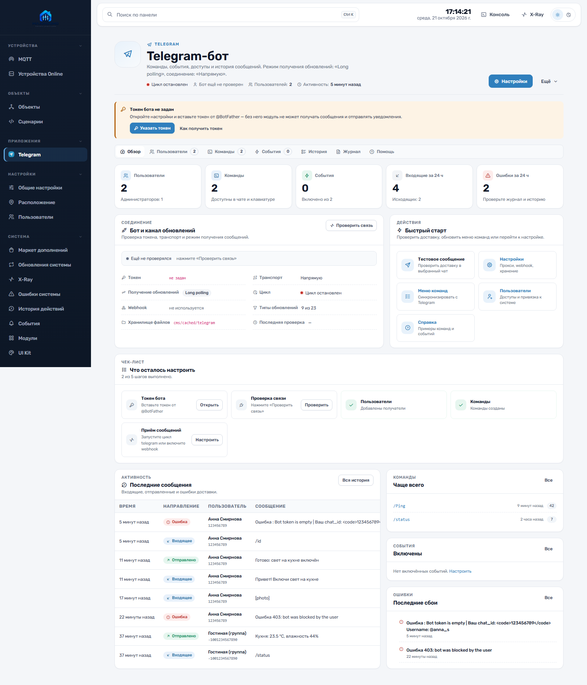
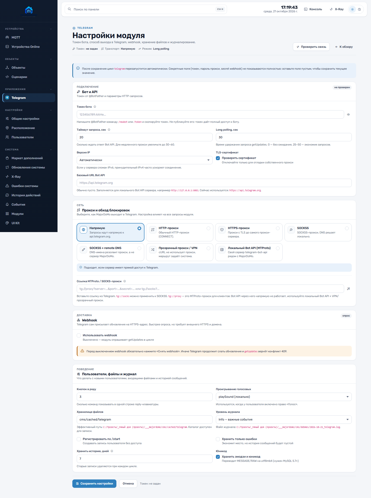
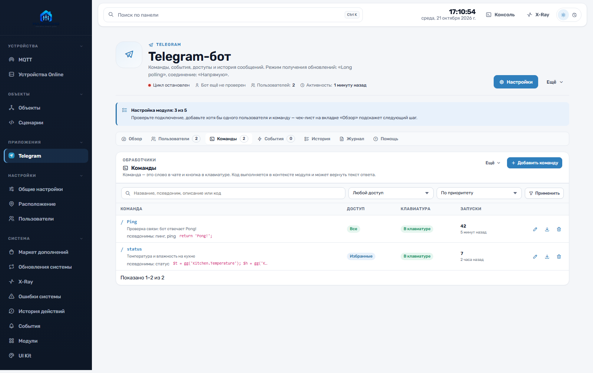
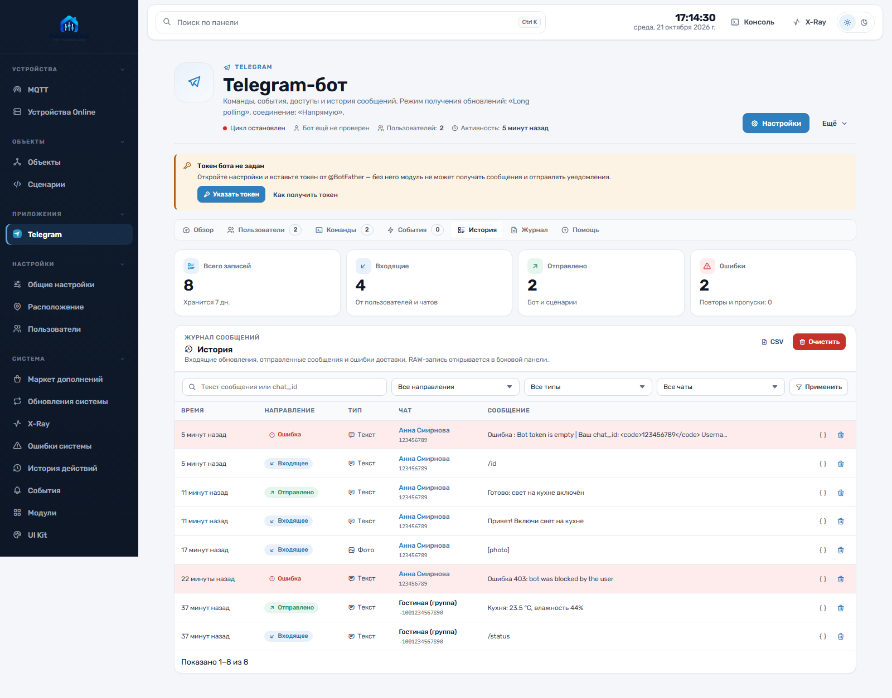

# Telegram для MajorDoMo

Модуль Telegram-бота для MajorDoMo: команды, события, доступы, история сообщений,
webhook и гибкая настройка транспорта (HTTP/SOCKS5-прокси, прозрачный прокси/VPN,
локальный Bot API по MTProto).

Модуль переписан под новую админку на Bootstrap 5 / `MDJUI` и новую структуру
MajorDoMo: `modules/`, `templates/`, `public/assets/modules/`, `public/` и
`scripts/`. Ядро патчить не нужно.



## Что нового по сравнению с версией 2017–2019

- **Современный UI**: рабочее пространство с вкладками «Обзор», «Пользователи»,
  «Команды», «События», «История», «Журнал», «Помощь»; KPI, фильтры, поиск,
  серверная пагинация, empty-state, тёмная тема и мобильная вёрстка.
- **Новый клиент Bot API** (`TelegramApi.php`): JSON-запросы, multipart-загрузки,
  TLS-проверка по умолчанию, таймауты, IPv4/IPv6, подробные ошибки с подсказками.
- **Транспорт**: напрямую, HTTP, HTTPS, SOCKS5, SOCKS5 с remote DNS,
  прозрачный прокси/VPN и локальный Bot API сервер (`telegram-bot-api`, MTProto).
- **Webhook**: secret token, `allowed_updates`, `max_connections`,
  `drop_pending_updates`, проверка статуса и снятие webhook из интерфейса.
- **Новые типы обновлений**: реакции, business-сообщения, изменения участников,
  заявки на вступление, inline-запросы, video note, контакты, venue, dice,
  анимации, правки сообщений, посты каналов, платежи.
- **Команды**: псевдонимы, приоритет, доступы (админы/избранные/все), показ в
  клавиатуре, условия, счётчик запусков, импорт/экспорт JSON, примеры кода.
- **События**: 22 типа с описанием переменных и готовыми примерами; счётчики
  запусков и последнего запуска.
- **Надёжность цикла**: offset `getUpdates` хранится в конфиге и не теряется при
  перезапуске; повторная отправка ошибок; защита от дублей webhook.
- **Журнал и диагностика**: просмотр `cms/debmes/*_telegram.log`, скачивание,
  очистка, RAW-запись любого сообщения в боковой панели.
- **Совместимость**: старые публичные методы модуля и таблицы сохранены,
  схема обновляется автоматически, старые URL продолжают открываться.

|Обзор|Настройки|
|---|---|
|||

|Команды|История|
|---|---|
|||

## Требования

- MajorDoMo с новой админкой (`MDJUI`, Bootstrap 5, `resources/css/ui-system.css`),
  Vite-бандл собран.
- PHP 8.1+ (проверено на PHP 8.4), расширения `curl`, `mbstring`, `json`.
- MySQL 5.7+ / MariaDB 10.2+ (для эмодзи — `utf8mb4`).
- Для webhook — внешний HTTPS-домен с валидным сертификатом.
- Для локального Bot API — Docker или собранный `telegram-bot-api`.

## Установка

Скопируйте файлы в корень MajorDoMo, сохраняя структуру:

```text
modules/telegram/                  # класс модуля, API-клиент, include-файлы
templates/telegram/                # шаблоны админки
public/assets/modules/telegram/    # page-CSS и page-JS
public/assets/img/modules/telegram.png
public/webhook_telegram.php        # точка входа webhook (document root)
scripts/cycle_telegram.php         # цикл опроса getUpdates
```

При первом открытии `/panel/telegram.html` модуль сам создаст таблицы и запись в
`project_modules`, после чего появится в меню «Приложения».

Альтернатива — установка через «Модули» / «Маркет дополнений»: разместите каталоги
и откройте страницу модуля.

### Цикл

Добавьте `cycle_telegram.php` в сервисы (X-Ray → службы) и запустите цикл. Цикл
нужен только для режима long polling; при включённом webhook он не обязателен.

### Webhook

1. Убедитесь, что `public/webhook_telegram.php` доступен по HTTPS.
2. В настройках включите «Использовать webhook».
3. Проверьте URL (по умолчанию `https://<домен>/webhook_telegram.php`).
4. Сгенерируйте secret token и нажмите «Установить webhook».

Точка входа проверяет заголовок `X-Telegram-Bot-Api-Secret-Token`; запросы без
правильного секрета отклоняются с 403. Telegram присылает обновления только по
HTTPS, поэтому для локальной разработки используйте long polling.

## Настройка

### Токен

Получите токен у [@BotFather](https://t.me/BotFather) (`/newbot` или `/token`) и
вставьте в «Настройки → Бот и API». Токен не показывается полностью; пустое поле
при сохранении означает «не менять».

Кнопка «Проверить связь» вызывает `getMe`, сохраняет имя, username и аватар бота и
показывает задержку. Ошибки 401/409/429/403 сопровождаются подсказками.

### Транспорт и обход блокировок

| Режим | Когда использовать |
|---|---|
| Напрямую | Сервер имеет прямой доступ к `api.telegram.org`. |
| HTTP / HTTPS-прокси | Есть корпоративный или личный прокси. |
| SOCKS5 | Tor (`127.0.0.1:9050`), dante, ssh-туннель. |
| SOCKS5 + remote DNS | DNS-имена резолвит прокси — надёжнее при блокировке DNS. |
| Прозрачный прокси / VPN | Маршрут задан системой: VPN, tun2socks, redsocks, nginx stream со SNI. |
| Локальный Bot API (MTProto) | Рядом запущен `telegram-bot-api`; PHP ходит на localhost. |

Для локального Bot API:

```bash
docker run -d --name telegram-bot-api \
  --restart unless-stopped \
  -p 127.0.0.1:8081:8081 \
  -e TELEGRAM_API_ID=<API_ID> \
  -e TELEGRAM_API_HASH=<API_HASH> \
  -v /srv/telegram-bot-api:/var/lib/telegram-bot-api \
  aiogram/telegram-bot-api:latest \
  --local --api-id=<API_ID> --api-hash=<API_HASH> --http-port=8081
```

В настройках выберите «Локальный Bot API (MTProto)» и укажите базовый URL
`http://127.0.0.1:8081`. `api_id`/`api_hash` нужны только для запуска сервера и
генерирования команды; в запросах Bot API они не передаются.

> **Про MTProto-прокси.** Ссылки `tg://proxy?…` описывают MTProto-прокси для
> клиентов Telegram. Bot API не умеет работать через них напрямую. Модуль
> разбирает такие ссылки и объясняет варианты: локальный Bot API (он сам ходит по
> MTProto) или прозрачный прокси/VPN. Ссылки `tg://socks?…` можно применить к
> полям SOCKS5 одной кнопкой.

### Webhook и опрос

- Long polling: нужен исходящий HTTPS, цикл должен быть запущен.
- Webhook: нужен внешний HTTPS-домен, цикл не нужен.
- Нельзя использовать оба режима одновременно: `getUpdates` вернёт 409, пока
  webhook активен. Перед отключением webhook нажмите «Снять webhook».

### Пользователи и доступы

Пользователь появляется в списке после `/start` (если включена регистрация) или
после ручного добавления chat_id. Права:

- **Администратор бота** — доступ ко всем командам;
- **Команды** — выполнение команд и клавиатура;
- **Уведомления** — получение системных сообщений (SAY);
- **Свободный текст** — передача сообщений в системный чат;
- **Приём файлов** — скачивание фото/видео/документов в хранилище;
- **Проигрывание голоса** — voice/audio на сервере.

Привязка к пользователю MajorDoMo (`MEMBER_ID`) нужна для геолокации, системного
чата и сценариев. Любой зарегистрированный пользователь может отправить `/id` и
узнать свой chat_id.

### Команды

Команда срабатывает по точному названию или псевдониму; остаток строки приходит в
`$args`. В коде доступны `$chat_id`, `$text`, `$args`, `$user`, `$message`,
`$telegram_module`. Строка, возвращённая из кода, отправляется ответом.

```php
// /ping
return 'Pong!';
```

```php
// /status
$t = gg('Kitchen.Temperature');
$h = gg('Kitchen.Humidity');
return 'Кухня: ' . $t . ' °C, влажность ' . $h . '%';
```

Inline-кнопки:

```php
$inline = $this->buildInlineKeyBoard([
    [
        $this->buildInlineKeyboardButton('Свет', '', 'cmd:light'),
        $this->buildInlineKeyboardButton('Статус', '', 'cmd:status'),
    ],
]);
$this->sendMessage($chat_id, 'Выберите действие:', '', 'HTML', $inline);
```

`callback_data` вида `cmd:<команда>` выполняет команду; остальные callback-данные
попадают в событие «Нажатие inline-кнопки».

### События

Событие — обработчик одного типа обновления. Включённые события выполняются по
порядку; `$skip = true;` останавливает цепочку. В редакторе есть описание
переменных и готовый пример для каждого типа.

```php
// Текстовое сообщение
if (mb_stripos($text, 'привет') !== false) {
    $this->sendMessageToUser($chat_id, 'Привет, ' . $fullname . '!');
    $skip = true;
}
```

Доступные типы: текст, фото, голос, аудио, видео, документ, стикер, геолокация,
callback, ответ на опрос, video note, контакт, venue, dice, анимация, правка
сообщения, пост канала, участники/сервисные события, реакции, inline-запрос,
business-сообщения, платежи.

### Программный API

Старые методы сохранены:

```php
include_once(DIR_MODULES . 'telegram/telegram.class.php');
$telegram = new telegram();

$telegram->sendMessageToUser($chat_id, 'Текст <b>HTML</b>');
$telegram->sendMessageToAdmin('Уведомление');
$telegram->sendMessageToAll('Всем');
$telegram->sendImageToUser($chat_id, '/path/photo.jpg', 'Подпись');
$telegram->sendVideoToAdmin('/path/video.mp4', 'Видео');
$telegram->sendFileToUser($chat_id, '/path/report.pdf');
$telegram->sendVoiceToUser($chat_id, '/path/voice.ogg');
$telegram->sendLocationToAdmin(55.75, 37.61);
$telegram->sendVenueToUser($chat_id, 55.75, 37.61, 'Дом', 'Москва');
```

Новые возможности доступны через `$telegram->getApi()`:

```php
$api = $telegram->getApi();
$api->sendContact($chat_id, '+7...', 'Анна');
$api->sendPoll($chat_id, 'Вопрос', [['text' => 'Да'], ['text' => 'Нет']]);
$api->editMessageText($chat_id, $message_id, 'Новый текст');
$api->deleteMessage($chat_id, $message_id);
$api->getChat($chat_id);
$api->setMyCommands([['command' => 'ping', 'description' => 'Проверка связи']]);
```

## Структура

```text
modules/telegram/
  telegram.class.php          # модуль: админка, обработка обновлений, API-обёртки
  TelegramApi.php             # HTTP-клиент Bot API (прокси, TLS, upload/download)
  TelegramUpdate.php          # нормализация Update и типов событий
  telegram_helpers.inc.php    # метаданные, форматирование, примеры, пагинация
  telegram_user_edit.inc.php  # карточка пользователя
  telegram_cmd_edit.inc.php   # карточка команды
  telegram_event_edit.inc.php # карточка события
templates/telegram/           # shell, вкладки, списки, формы, помощь
public/assets/modules/telegram/
  telegram.css                # только локальные стили модуля
  telegram.js                 # AJAX, панели, RAW-drawer, журнал, примеры
public/webhook_telegram.php   # webhook endpoint
scripts/cycle_telegram.php    # цикл long polling
```

Маршруты используют существующий generic-роутинг ядра:

```text
/panel/telegram.html
/panel/telegram.html?view_mode=settings
/panel/telegram.html?view_mode=edit_cmd&id=12
/panel/telegram.html?tab=history
```

Старые ссылки (`?tab=cmd`, `?tab=events`, `?tab=users`, `?view_mode=user_edit`,
`?view_mode=cmd_edit`, `?view_mode=event_edit`, `?webhookinfo=1`, `?getlog=1`,
`?sendMessage=1`) продолжают работать.

## Обновление с версии 2017–2019

1. Сделайте резервную копию БД и файлов модуля.
2. Замените `modules/telegram`, `templates/telegram`, `scripts/cycle_telegram.php`.
3. Переместите `webhook_telegram.php` в `public/` (document root).
4. Откройте модуль: схема обновится автоматически (добавятся `USERNAME`,
   `LAST_SEEN`, `ALIASES`, `RUNS`, `LAST_RUN`, `MESSAGE_ID`, `CHAT_TITLE`,
   `ENDPOINT`, индексы).
5. Проверьте настройки: старые `TLG_USEPROXY` / `TLG_PROXY_TYPE` /
   `TLG_PROXY_URL` мигрируют в новый транспорт.
6. Перезапустите цикл `telegram`.

Старые таблицы `tlg_user`, `tlg_cmd`, `tlg_event`, `tlg_user_cmd`, `tlg_history`
не переименовываются и не очищаются.

## Безопасность

- Токен, пароль прокси и `api_hash` не выводятся полностью; пустое поле сохраняет
  текущее значение.
- Webhook проверяет secret token; без него запросы отклоняются.
- `TLS-проверка` включена по умолчанию. Отключение — только для отладки.
- Код команд и событий выполняется через `eval()` в контексте PHP-модуля. Доступ к
  редактору есть только у авторизованных администраторов панели; не давайте
  доступ к админке недоверенным пользователям.
- Файлы сохраняются только при включённом праве «Приём файлов»; имена
  санитизируются, загрузка ограничена 50 МБ.
- Модуль не логирует токен и пароли.

## Проверка

```bash
php -l modules/telegram/telegram.class.php
php -l modules/telegram/TelegramApi.php
node --check public/assets/modules/telegram/telegram.js
```

Сценарии для ручной проверки:

1. `/panel/telegram.html` — обзор, KPI, чек-лист.
2. Настройки → «Проверить связь» с валидным токеном.
3. Создать команду `/ping`, отправить боту `/ping` и `/пинг`.
4. Включить событие «Текстовое сообщение», отправить текст.
5. Открыть историю, нажать `{}` — RAW-запись в drawer.
6. Включить webhook, нажать «Статус», затем «Снять webhook».
7. Проверить 390 px и тёмную тему.

## Лицензия и авторство

Модуль развивает исходный `majordomo-telegram` (автор Isupov Andrey). Изменения
UI/транспорта/API выполнены для текущей ветки MajorDoMo. Лицензия наследуется от
исходного репозитория; отдельных ограничений в коде не добавлено.
